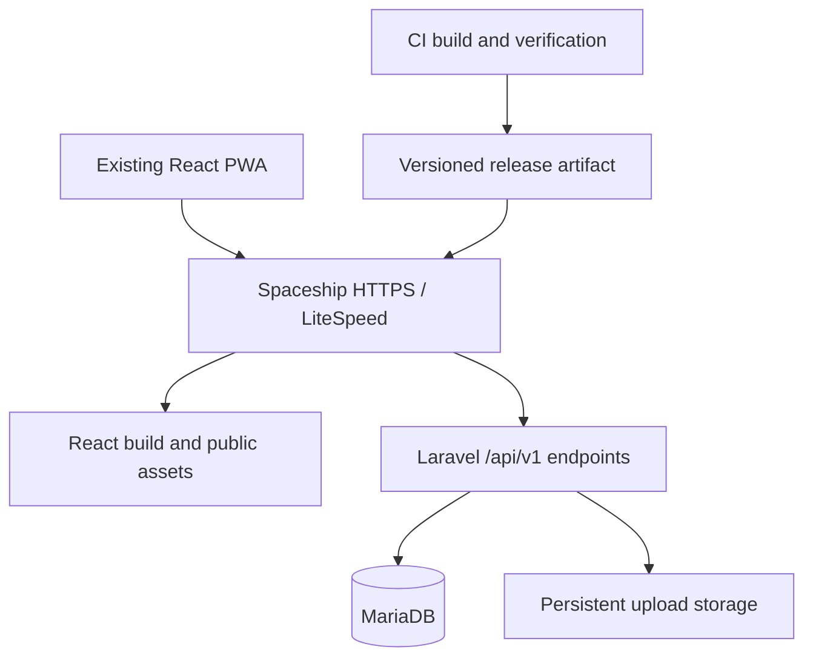

# K-CONNECT: Spaceship PHP migration design

Date: 2026-10-19 (Asia/Calcutta)  
Status: Design baseline for review; implementation has not started.  
Companion: [Phased implementation plan](MIGRATION_IMPLEMENTATION_PLAN.md)

## 1. Objective and binding requirements

Move the complete application to Spaceship shared hosting using React, Laravel and MariaDB. Preserve the existing UI and implemented functionality. Automate repeatable deployment and rollback. Develop in individually verifiable phases.

This document authorizes no deployment or application changes. The current task delivers documentation only. Hosting-specific choices remain conditional until Phase 0 verification.

### Compatibility boundary

- Keep layouts, styling, labels, navigation, routes, responsive behavior, form interactions, validation feedback, pagination, filters and existing workflows.
- Keep React, TypeScript, Vite, Tailwind, Zustand and the existing components. Do not introduce Blade/Inertia, redesign pages or upgrade frontend frameworks as part of migration.
- Preserve API paths, methods, request/response contracts, permissions, existing identifiers and file links wherever possible.
- Preserve unfinished pages and placeholder API behavior as placeholders. Do not implement roadmap features during migration.
- Internal API-client transport adjustments are permissible only when unavoidable, documented and verified to leave the user experience unchanged. Prefer server-side compatibility.
- Security defects and broken existing behavior are recorded separately. Do not silently redefine them as features or silently change access rules. Affected release gates require an explicit resolution decision.
- A maintenance window and one-time session reauthentication are operational exceptions requiring agreement before cutover, not assumed changes to normal functionality.

## 2. Evidence and current state

Source inspection found 58 route decorators under `backend/app/api/v1`, plus `/health`, and 13 model tables. This is a source inventory, not a runtime or production audit. No production data, hosting credentials or live resources were accessed.

| Concern | Source of truth | Observation |
|---|---|---|
| API registration | `backend/app/main.py` | `/api/v1` prefixes; uploads served by FastAPI |
| API contracts | `backend/app/api/v1`, `backend/app/schemas`, `frontend/src/api` | Route-specific JSON and validation behavior |
| Database | `backend/app/models`, `backend/alembic/versions` | PostgreSQL UUIDs, arrays, enums and SQL |
| Authentication | `backend/app/services/auth_service.py`, `core/security.py`, `dependencies/auth.py` | JWT access/refresh, bcrypt, SHA-256 refresh-token hashes |
| Frontend auth | `frontend/src/api/client.ts`, `store/authStore.ts` | Bearer headers, refresh queue, local-storage persistence |
| UI route inventory | `frontend/src/routes/index.tsx` | Public, expert and admin pages, including placeholders |
| Deployment | `services.bat`, `iis`, `deployment` | Development launcher; deployment directories contain placeholders |
| PWA | `frontend/vite.config.ts` | Network-first API cache; same-origin API and upload URLs |

README and architecture documents contain historical assumptions. Actual code and approved runtime baseline take precedence where they differ.

### Known issues to resolve before release

1. Opportunity files are written to repository-level `uploads/opportunities`; the static mount serves `backend/uploads`. Inventory both and resolve collisions/missing files without overwriting evidence.
2. Registration accepts a role enum including administrative roles without a visible public-role restriction. Phase 0 must confirm intended public roles; Phase 2 must prevent privilege escalation. This is a security exception, not a new product feature.
3. All uploads are currently statically served. Intended CV/document privacy is unconfirmed. Retain URL compatibility; any change to who may download requires a recorded policy decision and compatibility assessment.
4. Authenticated API responses may enter the service-worker cache. Test logout, account switching and offline behavior; define any security correction separately from normal feature parity.
5. Multipart PUT is used for achievement updates. Verify native parsing on the selected runtime/framework before deciding whether a transport-only POST/method-override adjustment is necessary.
6. Migrations contain PostgreSQL-specific and destructive operations. Do not replay them on MariaDB or use them as a production data-conversion script.

## 3. Target architecture and decisions

| Decision | Design |
|---|---|
| Backend | Laravel API, conventional PHP request lifecycle |
| Framework/runtime | Laravel 13 / PHP 8.3+ candidate; freeze supported exact versions after host verification |
| Database | Account-provided MariaDB version, InnoDB and utf8mb4; explicit collation decisions |
| Frontend | Existing code and locked dependencies; build outside hosting |
| Authentication | Preserve JWT API for migration; no Sanctum switch in baseline |
| Origin | Existing application origin and `/api/v1`; no new cross-origin dependency |
| Persistence | Shared storage and environment configuration outside versioned releases |
| Background services | None required initially; no dependency on Redis, permanent workers or WebSockets |
| Deployment | Build once, deploy the same artifact to staging then production |
| Development isolation | Proposed `backend-php/` alongside unchanged `backend/` until migration is accepted |

Laravel layers: routes -> authentication/authorization middleware -> validated requests -> controllers/services -> Eloquent/query builder -> explicit response serializers. Services own transactions and business rules. Controllers must not expose Eloquent objects indiscriminately.

Proposed future directories: `backend-php/` for the API, `deployment/spaceship/` for release tooling, `tests/contracts/` for shared API fixtures, and CI configuration appropriate to the repository provider. These directories are proposals, not created application scaffolding.

### Routing

Serve real frontend assets directly. Route `/api/v1/*` to Laravel, preserving JSON 404/405 errors. Route `/health` to the compatibility health endpoint. Resolve `/uploads/*` through the approved storage mapping. Only frontend navigation paths fall back to the React shell. Unknown asset/API paths must not return HTML with status 200. Preserve query strings, authorization headers and multipart bodies. Test trailing-slash behavior and method-preserving redirects.

The domain document root must expose only public entry points/assets. Do not expose application source, vendor internals, `.env`, exports, logs or backups. If the host cannot point the domain at a release's public directory, establish an equivalent public-only layout in Phase 0; never solve this by exposing the project root.

## 4. API and functional parity specification

All paths below are relative to `/api/v1`. Counts include placeholder routes. Validate the final expanded inventory against runtime OpenAPI in Phase 0 without modifying production.

| Module | Routes to preserve | Count |
|---|---|---:|
| Auth | POST `/auth/register`, `/login`, `/refresh`, `/logout`; GET `/auth/me` | 5 |
| Users | GET `/users/me`, `/users/`, `/users/me/profile`, `/users/me/completion`; PUT profile; POST profile/photo | 6 |
| Academic | GET/POST `/users/me/academic`; PUT/DELETE `/{entry_id}` | 4 |
| Experience | GET/POST `/users/me/experience`; PUT/DELETE `/{entry_id}` | 4 |
| Expertise | GET/PUT `/users/me/expertise` | 2 |
| Preferences | GET/PUT `/users/me/preferences` | 2 |
| Achievements | GET/POST `/users/me/achievements`; PUT/DELETE `/{entry_id}` | 4 |
| Service delivery | GET/PUT `/users/me/service-delivery` | 2 |
| Opportunity browsing | GET `/opportunities`, `/{opportunity_id}` | 2 |
| Admin users | GET `/admin/users`, `/{user_id}`; PATCH `/{user_id}` | 3 |
| Admin organizations | GET/POST `/admin/organisations`; GET/PUT/DELETE `/{org_id}` | 5 |
| Admin categories | GET/POST `/admin/categories`; PUT/DELETE `/{cat_id}` | 4 |
| Admin opportunities | GET/POST collection; GET/PUT/DELETE item; POST publish/archive; POST attachments; DELETE attachment | 9 |
| Admin dashboard | GET `/admin/dashboard` | 1 |
| Organization placeholders | GET/POST `/organizations/` | 2 |
| Application placeholders | GET/POST `/applications/` | 2 |
| Dashboard placeholder | GET `/dashboard/` | 1 |
| Total | Plus unversioned GET `/health` | 58 |

For every operation capture: method/path, role and ownership requirements, input fields and defaults, absent/null/empty behavior, error codes/body, output types, order, pagination, side effects and example fixtures. Do not assume all paginated schemas are identical; inspect opportunity-listing schema separately.

Compatibility rules:

- Preserve `detail` errors, including structured validation details where present, rather than Laravel default error envelopes.
- Preserve UUID strings, enum values, boolean types, decimal response types, date/time formatting and computed fields such as full name and profile completion.
- Preserve missing-field partial updates. Laravel's default string trimming/empty-to-null middleware must be evaluated per contract, not applied blindly.
- Preserve bodyless 204 responses, success status codes and duplicate/conflict behavior.
- Preserve existing pagination keys, defaults, ordering, count semantics and filter combinations.
- Preserve British `/admin/organisations` and existing American `/organizations` paths.
- Preserve draft creation rules, publish/archive conditions, attachment limits and organization deletion restrictions.
- Explicit field allowlists prevent clients modifying ownership, administrative flags or privileged roles through generic model assignment.
- Include tests for Python/PHP differences in rounding, truthiness, date parsing and null serialization; profile completion must produce identical output.

### UI baseline

Capture representative desktop/mobile screenshots and interaction recordings for login, registration, dashboard, all profile tabs, opportunity browsing/detail, admin users/verification, organizations, categories, opportunity create/edit/preview/publish/archive, and admin dashboard. Inventory all remaining routes and confirm placeholder behavior. Use fixed fixtures, viewport, browser and fonts for comparisons. No changed text, spacing, controls or navigation is accepted as incidental migration work.

## 5. Authentication design

Implement the existing bearer contract with a maintained JWT library selected during Phase 2. Preserve configured algorithm, `sub`, `type`, `exp`, role claims, access/refresh distinction, hashed refresh-token lookup, expiry and revocation. Validate algorithm explicitly. Query current active status and role server-side; do not trust client-supplied roles.

Preserve login, registration, `/auth/me`, `/users/me`, refresh and logout responses. Current refresh issues an access token without rotating the refresh token; preserve that behavior in the compatibility baseline. Maintain the frontend refresh queue semantics. Configure Laravel to use `password_hash` and UUID user IDs rather than default assumptions.

Test existing bcrypt hashes using synthetic known passwords generated by the old implementation, including Unicode and relevant length boundaries. Never export plaintext passwords. Preserve hashes byte-for-byte; rehash only after successful verification if required by an agreed policy.

Default cutover proposal: invalidate old sessions and request one normal login, subject to operational acceptance. If uninterrupted sessions are required, test imported refresh hashes, expiry, old JWT verification and safe key handling before selecting that alternative. Laravel APP_KEY is distinct from the JWT key and remains stable between releases. Rollback implications must be documented for either choice.

## 6. MariaDB design and data migration

### Table coverage

Preserve domain records for `users`, `refresh_tokens`, `academic_details`, `experience_entries`, `user_expertise`, `user_preferences`, `achievements`, `user_service_delivery`, `organizations`, `categories`, `opportunities`, `opportunity_attachments`, and `applications`. Preserve application records even though endpoints are placeholders. Framework bookkeeping tables are additional and do not change public contracts.

| Source representation | Target design |
|---|---|
| UUID PK/FK | Consistent CHAR(36), canonical values and matching collations; no ID regeneration |
| PostgreSQL enums | Explicit string values with application validation and appropriate DB constraints |
| Opportunity delivery modes | Child rows keyed by opportunity and position, indexed for membership |
| Tags/skills/target audience | Ordered JSON arrays initially to minimize semantic conversion; validate search compatibility |
| Experience skills, expertise audience levels, preference lists | JSON arrays preserving order, duplicates and null versus empty |
| Money | DECIMAL matching source precision, including fee DECIMAL(12,2) |
| Date/time | Dates and event times retain original semantics; timestamp instants normalized to UTC |
| Boolean | Explicit storage and response casts |

For tag/skill text search, replicate the existing comma-joined array substring search, including case/wildcard behavior, using tested derived search text or an equivalent expression maintained in the same transaction. Do not silently replace it with full-text search or exact membership. Preserve array order and duplicates. Derived search fields are internal and rebuilt during import. Revisit normalized tag tables only if parity and measured performance justify them.

Preserve foreign-key deletion rules, nullable fields, defaults and one-per-user constraints. Index foreign keys and query predicates based on the actual list/filter queries. Validate query plans before adding speculative indexes. Explicitly test Unicode, accents, case sensitivity and email duplicates against the chosen collation. Do not silently merge accounts or normalize historical values.

### Conversion procedure

1. Inventory live schema/version, row counts, constraints, sizes, timezone settings and both file roots; distinguish observed facts from repository assumptions.
2. Create a consistent PostgreSQL snapshot and a recoverable original backup. Export structured records and a manifest, not executable SQL for MariaDB.
3. Create a new MariaDB schema from Laravel migrations. Keep the original PostgreSQL history intact.
4. Import parents before dependents using a documented dependency graph. Load self-references in a second pass when needed. Avoid disabling constraints as a substitute for validation.
5. Preserve IDs and values. Record per-table counts, rejected rows and field-level conversion exceptions. A rerun into a clean staging database must produce the same result.
6. Map files by stored path, byte size and SHA-256. Quarantine conflicting paths for review. Never overwrite one source with another because names match.
7. Reconcile row counts, canonical field checksums, foreign keys, numeric totals, arrays and representative API responses. UUID/date/JSON normalization rules for checksums must be explicit.
8. During final cutover freeze old writes and drain active mutations, then take the final consistent snapshot/file copy. Do not allow both databases to accept production writes.

Do not dual-write PostgreSQL and MariaDB. Staging uses isolated synthetic or sanitized data. Production exports never enter Git or ordinary build artifacts.

## 7. Upload design

Store uploads outside release directories, with a compatibility mapping for existing `/uploads/...` links. Preserve names visible to users, MIME behavior and attachment metadata. Photos: 2 MB; CVs: 5 MB; achievements/opportunity files: 10 MB each; maximum five opportunity attachments. Verify exact byte boundaries and allowed types against source contracts.

Use temporary files and checked moves; coordinate database commits and file cleanup so failures do not produce successful records with absent files. Test replacement, deletion, interrupted upload, disk-full and concurrent attachment-limit requests. Prevent path traversal and execution of uploaded scripts. Apply the agreed access policy without breaking existing authorized workflows. PHP request/body limits must allow the existing per-request payload plus multipart overhead; no arbitrary reduction of limits.

## 8. Deployment automation design

### Hosting capability gate

Verify exact PHP web/CLI versions and extensions (including PDO MySQL, Fileinfo, Mbstring and OpenSSL), MariaDB version/collation, SSH key authentication, SFTP, archive extraction, checksums, permitted shell commands, symlink/rename behavior, document-root control, rewrite support, cron limits, storage/inodes, CPU/memory/process limits, upload/time limits, TLS, database backup/restore access and OPcache behavior. Jailed SSH advertising does not prove every deployment operation is available.

### Build and promotion

CI provider is intentionally not assumed. Use the repository's provider once known; the design is provider-independent.

1. On a change: install locked frontend/PHP dependencies in a Linux build environment matching target platform requirements; run contract/backend/frontend checks and the existing TypeScript/Vite build.
2. Produce one release archive containing PHP source, production Composer dependencies, React build, public routing assets, migrations and a manifest with commit, release ID, runtime requirements and checksums. Exclude secrets, uploads, node_modules, development dependencies and test data.
3. Transfer the archive to staging using SSH/SFTP. Pin the host key; use scoped CI secrets and a dedicated deployment identity where supported. Never disable host-key verification.
4. Verify checksum, disk/inode headroom, runtime compatibility and release manifest before extraction/activation. Serialize deployments per environment with a lock.
5. Attach environment-local configuration and persistent storage; build Laravel environment-dependent caches on the target, not in the artifact. Check permissions and PHP platform requirements.
6. Apply only reviewed pending migrations once. Database changes use expand/contract design so the previous release remains compatible through the rollback window.
7. Activate the release; run HTTP checks through the real HTTPS hostname and authenticated synthetic smoke tests in staging. Verify expected release identity and database readiness, not only a static 200.
8. Promote the exact validated artifact to production through the configured release workflow. Rebuilding for production is disallowed. Production mutation tests use dedicated test records only if explicitly enabled.
9. Record release/migration IDs, results, timing and rollback target without tokens or personal data. Retain the previous known-good releases and assets subject to measured disk budget.

Production promotion is a deliberate release operation after phase gates; routine staging deployments should be automated. No pipeline, secrets or remote account changes are created during this documentation task.

### Release layout and activation

Preferred private account layout: versioned `releases/<release-id>/`, `shared/.env`, `shared/storage`, private backup metadata and a `current` pointer; document root resolves to the active public directory. Shared data is never removed by release cleanup.

Use an atomic pointer switch only after the account proves symlink and web-server behavior. If unavailable, use prepared sibling directories and verified rename/public-entry switching under maintenance. If only SFTP/manual panel operations are possible, document the reduced-automation fallback and do not claim zero downtime. Never upload changed files piecemeal over a live release.

Preserve prior hashed React assets for the defined client-cache window so existing tabs continue to load chunks. Test service-worker update/rollback behavior and avoid deleting assets solely because they are absent from the newest build. Do not run blanket cache clears that erase shared sessions or unrelated cached data. Verify OPcache freshness using a release marker; do not assume permission to restart PHP or LiteSpeed.

### Automation targets

- No production npm/Composer dependency downloads: dependencies are packaged and platform-checked.
- No repeated manual copying or editing environment files per release.
- One release identity across staging and production; one deploy lock per environment.
- A failed preflight leaves the live release untouched.
- A failed activation does not reopen writes until consistency is known.
- Interrupted uploads, insufficient disk, migration failure, smoke failure and rollback failure have tested recovery paths.
- Record deployment and recovery duration during rehearsal; set agreed downtime/RTO targets from measurements, not assumptions.

### Rollback and data safety

Code rollback selects the prior artifact only when it remains compatible with the current schema and data. Do not automatically run destructive down migrations. Delay destructive schema cleanup until after the rollback window.

For the initial PostgreSQL-to-MariaDB switch, rollback before new writes can restore routing to the frozen old deployment. After MariaDB accepts writes, a simple DNS/code reversal loses data. Freeze writes and perform a rehearsed reverse reconciliation or forward repair; agree that decision before cutover. Define RPO/RTO, backup destination, encryption/access, retention and restore owner in Phase 0 and prove restoration in Phase 6. A backup existing is not proof of recoverability.

## 9. Verification and acceptance

| Dimension | Required evidence |
|---|---|
| API parity | Fixtures for every inventoried operation, success/error/permission cases; no unexplained differences |
| UI parity | Baseline screenshots and critical interaction tests at desktop/mobile widths; no unapproved visual or behavior changes |
| Authentication | Known bcrypt compatibility; login/refresh/logout; disabled users; expiry; denied roles and cross-user access |
| Data | All records accounted for; no unexplained checksum/count differences or orphaned relationships |
| Files | All referenced files accounted for or pre-existing missing-file exceptions explicitly accepted |
| Search | Matching filters, counts, sorting and pagination including Unicode, empty and multi-value inputs |
| Hosting | Actual host staging evidence, deep links, headers, multipart, TLS and resource limits |
| Automation | Repeated deploys, failed deploy recovery and rollback rehearsal |
| PWA | Existing install/offline behavior, account switching, old-tab assets and service-worker upgrade/rollback |

Use the same fixtures against both stacks for comparison. Normalize only explicitly nondeterministic values (e.g. fresh token bytes), while still checking claims and expiry semantics. Do not normalize away business differences.

Set measured latency/error/concurrency acceptance thresholds in Phase 0 using expected workload and current baseline. Retain the existing frontend's request timeout behavior. Readiness should verify database access and schema compatibility without exposing credentials; keep `/health` compatibility separately if its contract is static.

## 10. Decisions still requiring evidence

| Item | Owner role | Deadline |
|---|---|---|
| Exact hosting plan/runtime, filesystem and SSH capabilities | Hosting operator | Phase 0 |
| CI provider and staging domain/account isolation | Technical lead/operator | Phase 0 |
| Live data volume, traffic and backup access | Data owner/operator | Phase 0 |
| Public registration roles and document access policy | Product owner/security reviewer | Before affected Phase 2/3 acceptance |
| Session continuity or one-time re-login | Product owner | Before cutover rehearsal |
| Cache-related security exceptions | Technical lead/product owner | Phase 6 |
| Downtime, recovery targets and retention | Product owner/operator | Before Phase 6 rehearsal |

## 11. References

Provider/runtime claims were checked on 2026-10-19. Account-specific capabilities remain unverified.

- [Spaceship shared-hosting specifications](https://www.spaceship.com/en-GB/web-hosting/): advertised PHP/MariaDB/LiteSpeed/SSH/cron capabilities.
- [Laravel 13 deployment](https://laravel.com/framework/docs/13.x/deployment): PHP requirements, public root and environment-dependent optimization.
- [Laravel hashing](https://laravel.com/framework/docs/hashing): bcrypt support; existing hashes still require compatibility testing.
- [Laravel Sanctum](https://laravel.com/framework/docs/13.x/sanctum): alternative session authentication, deliberately outside this migration baseline.
- [PHP PUT support](https://www.php.net/manual/en/features.file-upload.put-method.php): multipart/runtime compatibility must be proven for existing achievement requests.

All proposed architecture, migration sequencing and release gates are project design decisions, not claims that Spaceship provides a managed Laravel deployment service.
